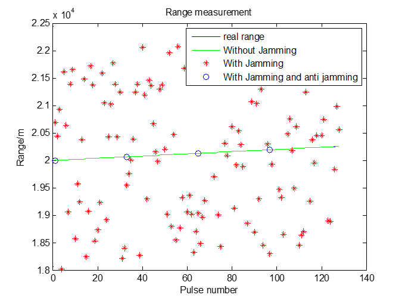
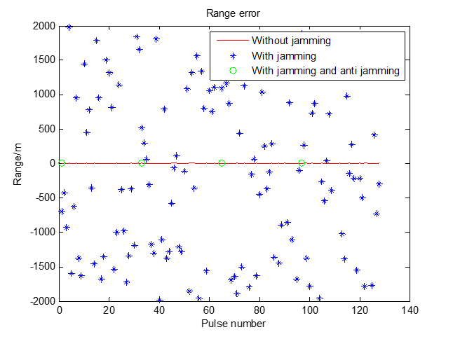
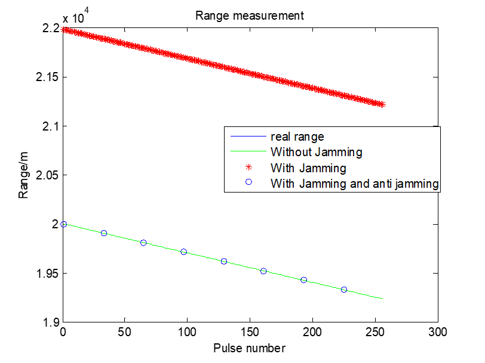
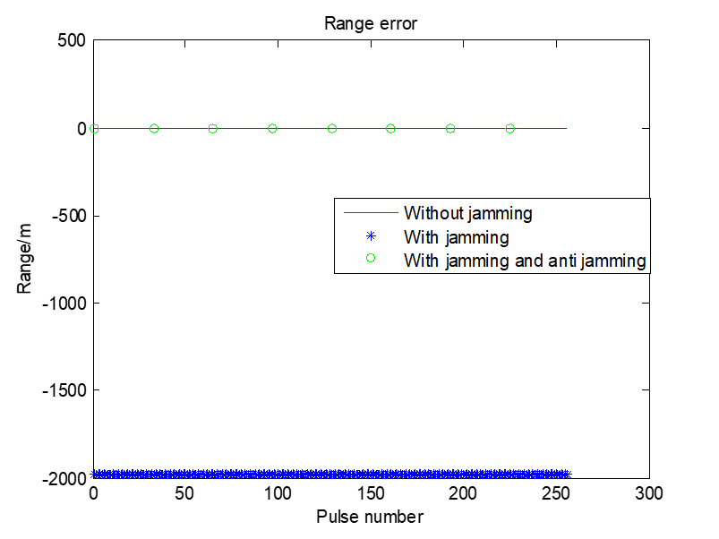

# [Radar Interference Reduction]Effectiveness Validation of False Targets at the Same Frequency Distance[With MATLAB Code]

1. Principle of Interference Reduction
Due to the fact that interference from simultaneous but asynchronous signals generally appears at different positions within continuous PRI, non-phase-coherent accumulation inherently has the effect of suppressing such interference. By employing non-phase-coherent accumulation, the amplitude of the asynchronous interference pulses is reduced, and after CFAR processing, it may not exceed the threshold, thereby achieving anti-interference effects.
The speed and the number of accumulated pulses affect test results:
•  
When the number of pulses is small and the relative motion velocity between the target and the radar is low, envelope alignment is not necessary;
•  
When the relative motion velocity is high (such as when the relative velocity between missiles and ships reaches 4000m/s), the distance movement between adjacent pulses is significant;
•  
If the number of accumulated pulses is large, the distance movement between the first pulse and subsequent pulses can also be significant, leading to poor non-coherent accumulation effects, or even enhancing false target signals, causing detection errors in target detection.
Therefore, it is necessary to perform distance movement correction on the mixed signal after pulse compression before performing non-phase-coherent accumulation, which will yield better results.
2. Anti-Interference Effect Demonstration
For distance pseudo targets, interference signals have a significant impact on radar ranging, while having no interference effect on Doppler radar ranging. Therefore, for anti-distance pseudo target interference, it is sufficient to combat only in the range dimension.
In the image, there is a comparison of four situations: true distance of the target, distance measurement values with interference, without countermeasures against interference, and after countermeasures against interference.
Image  
Range error comparison:  
Image  
Verification of anti-interference effect for distance pseudo target with simultaneous and synchronized pulses
1. Modification of the radar transmission signal to combat interference from synchronised distance pseudo-targets: After changing the PRT (Programmable Receiver Transmitter) of the transmission signal, the jammer can only utilize the signals received previously to generate interference signals. This results in a relative time delay between the interference signal and the target echo signal being no longer constant. At this point, the interference exhibits the same interference effect as that of asynchronous interference signals, which can be further combated using methods for asynchronous interference.
2. Demonstration of anti-jamming effectiveness: The presence of pseudo-target interference does not affect Doppler radar speed measurement but significantly impacts range measurement. Therefore, the primary focus of the anti-jamming is on the range dimension. Successful anti-jamming requires that the range measurement error remains within an acceptable range after the anti-jamming process.
Comparison results of real target distance, uninterrupted distance measurement values, distance measurement values with and without anti-jamming measures, and distance measurement values with and without anti-jamming measures:
Image  
Distance measurement error comparison chart:  
Image  
Completion.

## Images

<!-- PAYMENT_BLOCK -->

## Get this dataset

- Payment link (Stripe): [Buy now](https://buy.stripe.com/3cs8yP7sY87d0vu9AB)
- Payment QR code: 

<!-- /PAYMENT_BLOCK -->
